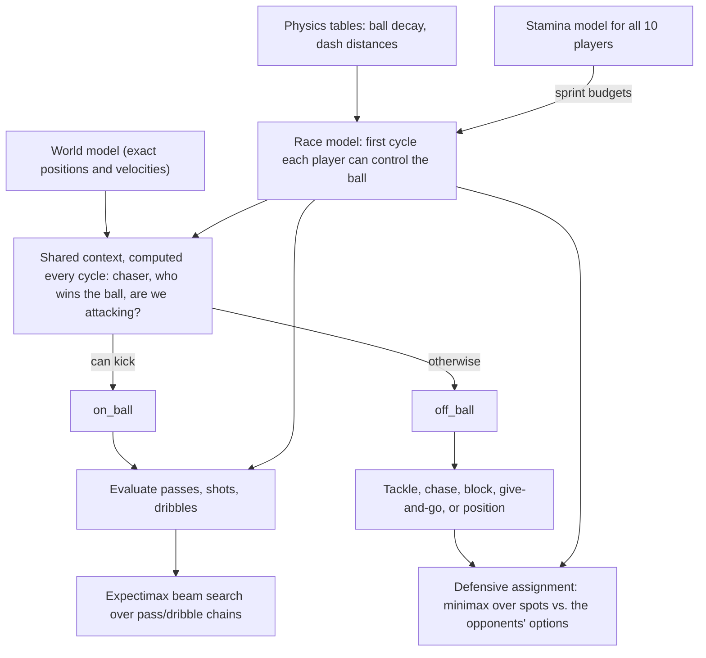

# RoboCup 2D Smart Game Tree

**Agent1**: a 5-a-side RoboCup 2D team that attacks with tiki-taka passing chains,
chosen by a game-tree search.

[](https://www.python.org/)
[](https://numpy.org/)
[](https://rcsoccersim.github.io/)
[](#how-it-works)
[](docs/design.md#5-on-the-ball)
[](docs/design.md#7-defensive-assignment)
[](#running-it)
[](#note-for-students)
[](LICENSE)

A team of simulated football players that decide what to do by **predicting races for
the ball** and **searching over chains of passes and dribbles**. No learned models: one
physical model of "who gets to the ball first" drives passing, shooting, dribbling,
chasing, blocking and defensive positioning.

Built by **Manya Jain** and **Arjun Shende** for Assignment 3 of COL333 (Artificial
Intelligence) at IIT Delhi, 2026.
<!-- TODO: link your GitHub profiles -->

<!-- TODO: add a short GIF of a goal, e.g. docs/media/goal.gif (record a replay
     with `python3 a3.py watch` in py2d/), and show it here:

-->

## What's ours, and what isn't

The game environment, the server and the match harness were provided. Our work is the
decision-making of the players.

| Part | Who made it |
|---|---|
| RoboCup soccer simulator ([rcssserver](https://github.com/rcsoccersim/rcssserver)) | RoboCup community |
| Python base team and gRPC proxy ([PY2D](https://github.com/Cyrus2D/Py2D)) | Cyrus2D team |
| Assignment harness ([fork of PY2D](https://github.com/TheAbry/COL333-Assignment-3-py2d-fork), included as the `py2d/` submodule): `a3.py`, the student interface, perception, formations, set pieces, **the goalkeeper**, penalties | COL333 course staff |
| HELIOS reference opponent (`full`) | HELIOS team, ships with PY2D |
| GIBBS replay viewer | Edward Moore, Oliver Obst (GPL-3) |
| **Agent1: everything in [`agent/`](agent/)** (the bundled [`agent.py`](agent.py)), [`tools/`](tools/), [`scripts/`](scripts/), [`docs/`](docs/) | **us** |

The framework calls two methods per player per cycle: `on_ball` when he can kick the
ball and `off_ball` otherwise. Those two methods, and everything behind them, are ours.

## How it works



- **Race model.** For any ball trajectory, predict the first cycle at which each player
  can control the ball, using the server's physics (ball decay, dash acceleration,
  turning inertia). It is vectorised with numpy, so hundreds of candidate kicks are
  raced against all players at once. Opponents get the benefit of the doubt (bigger
  reach, no turning needed); our tired teammates don't.
- **Passes, shots and dribbles** get a success probability from the race margin (their
  arrival minus ours), calibrated against our match logs. Each option's value is
  `p · 0.985^t · V(we keep it there) + (1 − p) · V(they win it there)`, on a scale of
  roughly "chance this possession ends in a goal".
- **On the ball:** shoot if the goal probability clears a situation-dependent
  threshold. Otherwise run an anytime **expectimax beam search** (width 24, depth 4).
  Every pass or dribble is a chance node, and each child state imagines the opponents
  pressing the receiver and our players making runs, including a give-and-go by the
  passer.
- **Off the ball:** the first applicable rule of: block a shot, tackle, tactical foul,
  chase, block the carrier's predicted dribble, continue a give-and-go, or take up a
  position.
- **Defence:** enumerate what the opponent carrier could do next (passes, dribbles,
  shots, plus one follow-up step), then try every assignment of defenders to candidate
  spots and keep the one that minimises the opponents' best remaining option.
- **Stamina:** every player estimates every other player's stamina by inverting the
  server's physics from observed movement. Stoppages are bridged with recovery tables
  fitted to our logs. Passes avoid teammates who can't make the sprint, and runs are
  paced to arrive just in time.
- **No communication:** players coordinate because each runs the same deterministic
  computation on the same world model.

The full write-up, with all the numbers, is in **[docs/design.md](docs/design.md)**.
Every tuning constant is explained in [`agent/config.py`](agent/config.py).

## Results

<!-- TODO: fill in. Run e.g. 20 matches per opponent (use -p to run in parallel). -->

| Opponent | Matches | W | D | L | Goals for | Goals against |
|---|---|---|---|---|---|---|
| HELIOS reference (`full`) | | | | | | |
| Course starter agent | | | | | | |
<!-- | Course leaderboard / tournament | | | | | | | -->

**Ablations** (what each component is worth):
<!-- TODO: turn one feature off at a time in agent/config.py, rebuild, replay the same
     number of matches against `full`, and record goal difference. -->

| Variant | Goal difference vs. `full` |
|---|---|
| Final Agent1 | |
| without give-and-go (`GIVE_GO = False`) | |
| without stamina-aware races (`STAM_RACE = False`) | |
| man-marking instead of the minimax assignment (`MAN_MARK = True`) | |
| without fitted pass calibration (`PASS_FIT = None`) | |

## What didn't work

<!-- TODO: your story. Things that are still in the code but switched off, which you
     could explain here:
     - the hysteresis recovery mode (STAMINA_MODE) and stamina signalling (STAM_SIGNAL)
     - alternative defences: MAN_MARK, STOPPER, LOW_BLOCK, MIDBLOCK
     - the chain search over field-evaluation scores (EXP_BEAM < 2)
     - the removed DRAIN_* (breakaways) and RUN_* (support runs) features
     For each: what you expected, what happened, and how you measured it. -->

## Running it

The starter needs Python 3.11 and x86_64 Linux or Apple-silicon macOS.

```bash
git clone --recursive https://github.com/sir12321/robocup-2d-smart-game-tree.git
cd robocup-2d-smart-game-tree/py2d
```

Then do the one-time setup from [`py2d/README.md`](py2d/README.md): install
`requirements.txt`, download the server and proxy binaries, and run `./generate.sh`.
Check it with `python3 a3.py doctor`.

```bash
cd ..
scripts/run_match.sh                  # Agent1 vs. the HELIOS reference team
scripts/run_match.sh starter          # Agent1 vs. the course starter agent
scripts/run_match.sh full -p 6010     # extra options go to `a3.py match`
```

Watch the replays with `python3 a3.py watch`, or see each player's decisions
cycle by cycle with `python3 a3.py why`, both from inside `py2d/`.

## Repository layout

```
agent/            Agent1's source, one module per concern (see agent/__init__.py)
agent.py          the single file the harness loads, generated from agent/
tools/bundle.py   builds agent.py from agent/ (and checks it is up to date)
scripts/          run_match.sh
docs/design.md    how it works, in detail
py2d/             the course's starter environment (git submodule, not our code)
```

### Changing the agent

Edit the modules in `agent/`, then rebuild the single file:

```bash
python3 tools/bundle.py            # agent/ -> agent.py
python3 tools/bundle.py --check    # is agent.py up to date?
```

`scripts/run_match.sh` rebuilds automatically if needed. After documentation-only
changes, `python3 tools/bundle.py --verify old_agent.py` confirms that the code itself
did not change (it compares the parsed program, ignoring comments and docstrings).

## License

Our code (everything outside `py2d/`) is released under the [MIT License](LICENSE).
The `py2d/` submodule is the course's starter environment and is not covered by it;
its components keep their own terms (for example, GIBBS is GPL-3).

## Acknowledgements

The COL333 course staff for the assignment and harness; the Cyrus2D team for PY2D;
the RoboCup Soccer Simulator maintainers; the HELIOS team for the reference opponent;
Edward Moore and Oliver Obst for GIBBS.

## Note for students

This was a course assignment. If you are taking COL333, follow your course's
academic integrity policy: read it for ideas if that's allowed, but don't copy it.
