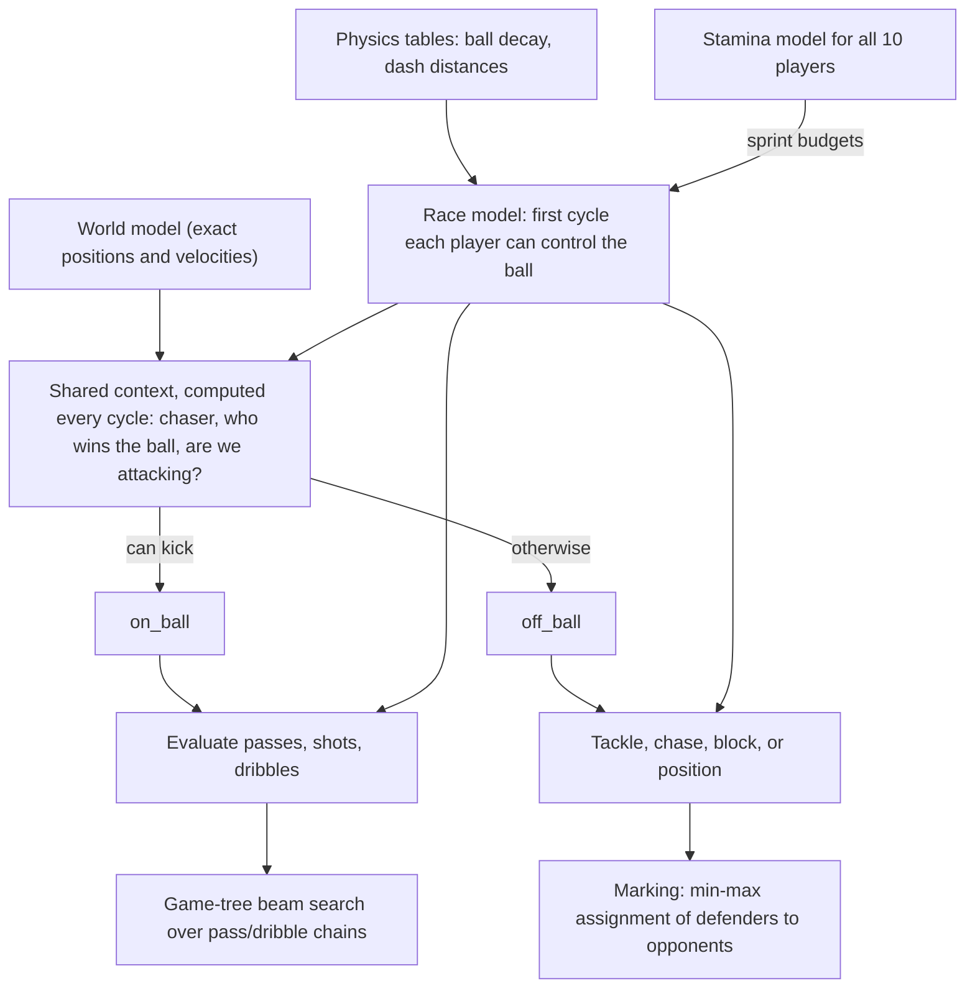

# RoboCup 2D Smart Game Tree Bot

**Agent1**: a 5-a-side RoboCup 2D team that attacks with tiki-taka passing chains,
chosen by a game-tree search.

[](https://www.python.org/)
[](https://numpy.org/)
[](https://rcsoccersim.github.io/)
[](#how-it-works)
[](docs/design.md#5-on-the-ball-the-game-tree-search)
[](docs/design.md#7-defensive-marking)
[](#running-it)
[](#note-for-students)
[](LICENSE)

A team of simulated football players that decide what to do by **predicting races for
the ball** and **searching over chains of passes and dribbles**. No learned models: one
physical model of "who gets to the ball first" drives passing, shooting, dribbling,
chasing, blocking and defensive positioning.

Built by **Manya Jain** and **Arjun Shende** for Assignment 3 of COL333 (Artificial
Intelligence) at IIT Delhi, 2026.
<!-- TODO: link your GitHub profiles -->

<!-- TODO: add a short GIF of a goal, e.g. docs/media/goal.gif (record a replay
     with `python3 a3.py watch` in py2d/), and show it here:

-->

## What's ours, and what isn't

The game environment, the server and the match harness were provided. Our work is the
decision-making of the players.

| Part | Who made it |
|---|---|
| RoboCup soccer simulator ([rcssserver](https://github.com/rcsoccersim/rcssserver)) | RoboCup community |
| Python base team and gRPC proxy ([PY2D](https://github.com/Cyrus2D/Py2D)) | Cyrus2D team |
| Assignment harness ([fork of PY2D](https://github.com/TheAbry/COL333-Assignment-3-py2d-fork), included as the `py2d/` submodule): `a3.py`, the student interface, perception, formations, set pieces, **the goalkeeper**, penalties | COL333 course staff |
| HELIOS reference opponent (`full`) | HELIOS team, ships with PY2D |
| GIBBS replay viewer | Edward Moore, Oliver Obst (GPL-3) |
| **Agent1: [`agent.py`](agent.py)**, plus [`scripts/`](scripts/), [`docs/`](docs/), [`results/`](results/) | **us** |

The framework calls two methods per player per cycle: `on_ball` when he can kick the
ball and `off_ball` otherwise. Those two methods, and everything behind them, are ours.

## How it works



- **Race model.** For any ball trajectory, predict the first cycle at which each player
  can control the ball, using the server's physics (ball decay, dash acceleration,
  turning inertia). It is vectorised with numpy, so hundreds of candidate kicks are
  raced against all players at once. Opponents get the benefit of the doubt (bigger
  reach, no turning needed); our tired teammates don't.
- **Passes, shots and dribbles** get a success probability from the race margin (their
  arrival minus ours). Dribbles and self-passes are simulated with the server's own
  player physics, kick by kick and dash by dash.
- **On the ball: tiki-taka as a game-tree search.** Shoot if the goal probability clears
  a threshold. Otherwise build a tree: our moves are safe passes and dribbles, and the
  opponents' reply is pessimistic (everyone runs at the new ball position). A beam
  search (width 10, depth 3) scores each chain by progress and scoring threat minus its
  risk, and plays the first pass of the best chain.
- **Off the ball:** the first applicable rule of: tackle (or a tactical foul), chase,
  block the carrier's predicted dribble, or take up a position. In attack, players
  make runs and look for open passing spots; in defence, every opponent is marked
  goal-side, with the assignment that minimises the longest run.
- **Stamina:** every player estimates every other player's stamina by inverting the
  server's physics from observed movement, with stoppages bridged by recovery tables
  fitted to our logs. Passes avoid teammates who can't make the sprint. Tired players
  switch to a recovery mode, and teammates read that from how they move.
- **No communication:** players coordinate because each runs the same deterministic
  computation on the same world model.

The full write-up, with all the numbers, is in **[docs/design.md](docs/design.md)**.

## Results

**400 full matches against HELIOS**, the reference team that ships with PY2D
(5-a-side, two halves of 750 cycles, alternating sides). **Agent1 plays HELIOS level:**
it goes unbeaten in 62% of matches, and its average goal difference is exactly zero.

| Opponent | Matches | Won | Drawn | Lost | Goals for | Goals against | Goal diff. per match | Points per match |
|---|---|---|---|---|---|---|---|---|
| HELIOS (`full`) | 400 | 149 (37.2%) | 99 (24.8%) | 152 (38.0%) | 572 (1.43 per match) | 573 (1.43 per match) | 0.00 ± 0.15 | 1.36 |

± is the 95% confidence interval; points are 3 for a win and 1 for a draw.

- **Most common scores:** 2–1 win (57 matches), 1–1 (52), 1–2 loss (50).
- **Biggest win** 5–1, **biggest loss** 0–4. Agent1 kept 58 clean sheets and failed to
  score in 78 matches.
- **No side bias:** goal difference per match is −0.03 in the 197 matches on the left
  and +0.02 in the 203 on the right.
- **Stable over the run:** in chronological blocks of 100 matches, goal difference per
  match was −0.17, +0.07, −0.15 and +0.24, all within the noise of a 100-match sample
  (about ±0.3).

Every match passed the harness's log checks (full length, five players a side), and the
scores agree with the server's own result logs. The per-match results are in
[`results/helios_400.csv`](results/helios_400.csv). In the match logs our team is named
`STARTER`. [`agent.py`](agent.py) is byte for byte the file that played these matches
(SHA-256 `828b466b…`).

## Running it

The starter needs Python 3.11 and x86_64 Linux or Apple-silicon macOS.

```bash
git clone --recursive https://github.com/sir12321/robocup-2d-smart-game-tree-bot.git
cd robocup-2d-smart-game-tree-bot/py2d
```

Then do the one-time setup from [`py2d/README.md`](py2d/README.md): install
`requirements.txt`, download the server and proxy binaries, and run `./generate.sh`.
Check it with `python3 a3.py doctor`.

```bash
cd ..
scripts/run_match.sh                  # Agent1 vs. the HELIOS reference team
scripts/run_match.sh starter          # Agent1 vs. the course starter agent
scripts/run_match.sh full -p 6010     # extra options go to `a3.py match`
```

Watch the replays with `python3 a3.py watch`, or see each player's decisions
cycle by cycle with `python3 a3.py why`, both from inside `py2d/`.

## Repository layout

```
agent.py          Agent1: the whole bot, in the one file the harness loads
agent_breakdown/  agent.py split by topic for reading (parts.py check: in sync)
scripts/          run_match.sh
docs/design.md    how it works, in detail
results/          per-match results against HELIOS
py2d/             the course's starter environment (git submodule, not our code)
```

## License

Our code (everything outside `py2d/`) is released under the [MIT License](LICENSE).
The `py2d/` submodule is the course's starter environment and is not covered by it;
its components keep their own terms (for example, GIBBS is GPL-3).

## Acknowledgements

The COL333 course staff for the assignment and harness; the Cyrus2D team for PY2D;
the RoboCup Soccer Simulator maintainers; the HELIOS team for the reference opponent;
Edward Moore and Oliver Obst for GIBBS.

## Note for students

This was a course assignment. If you are taking COL333, follow your course's
academic integrity policy: read it for ideas if that's allowed, but don't copy it.
